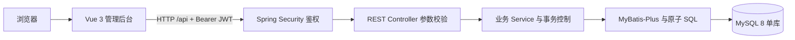
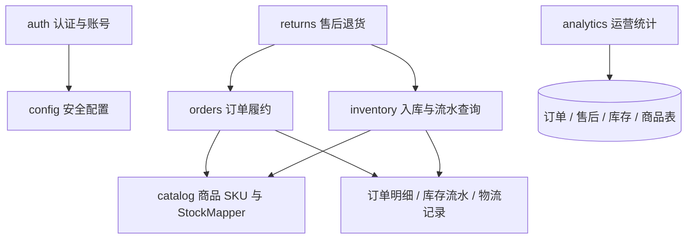
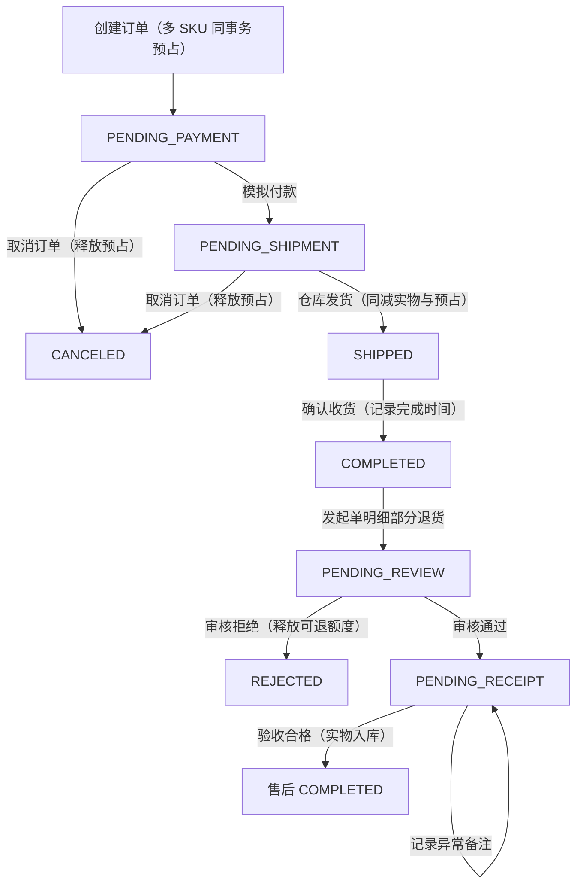
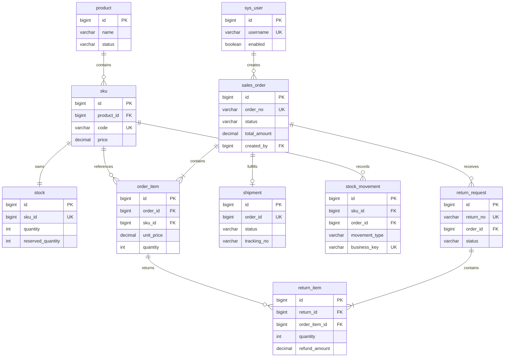
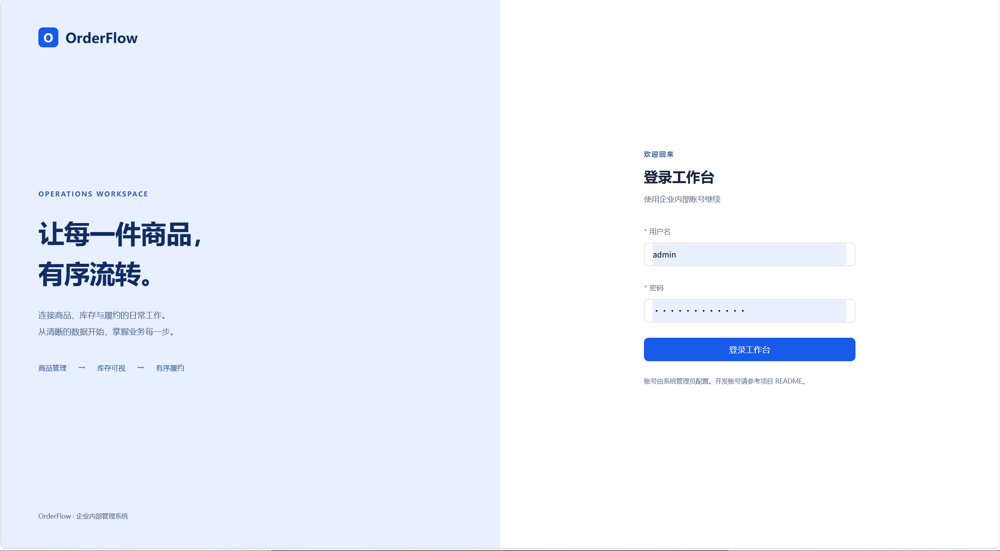
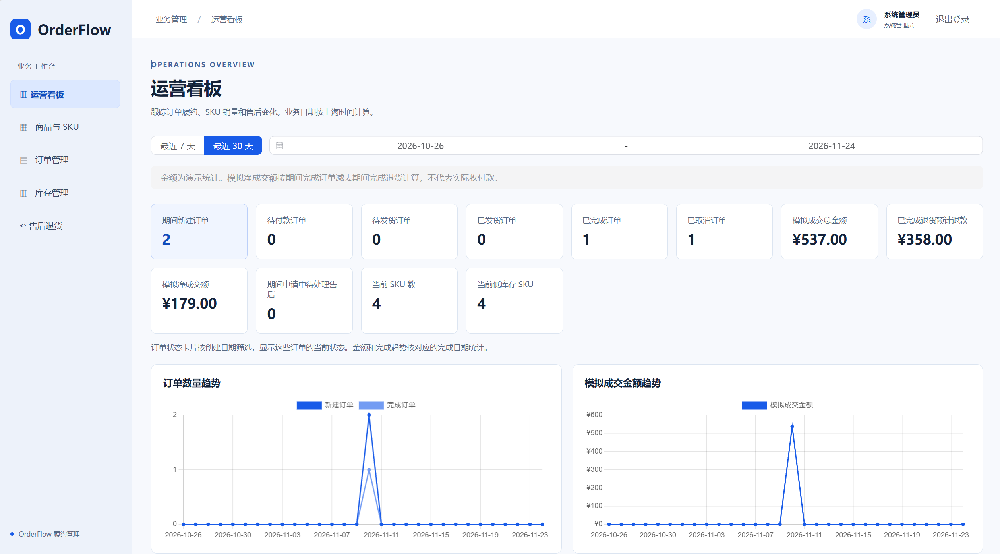
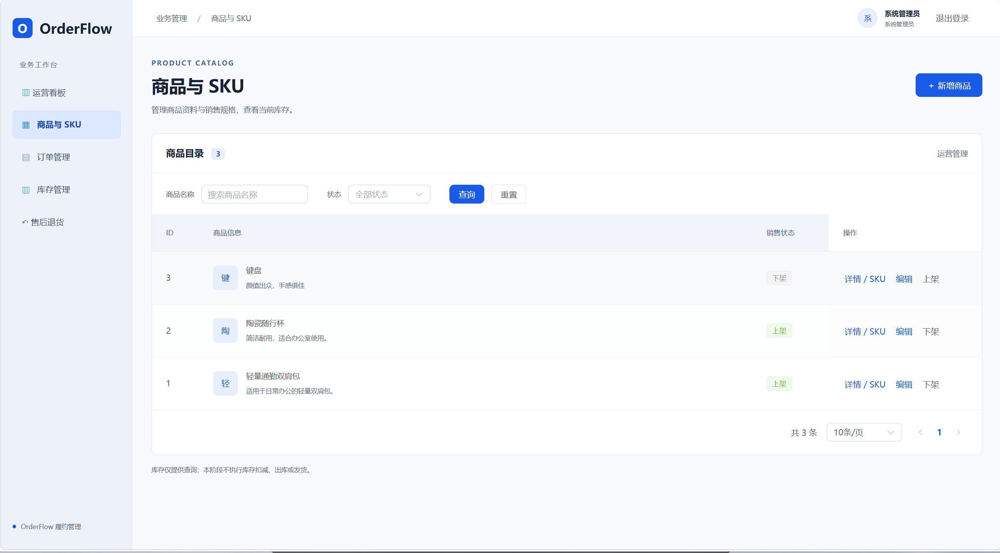
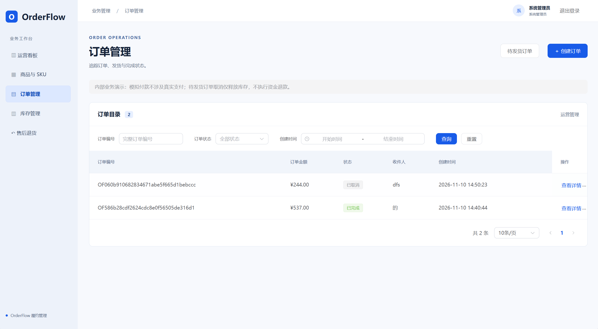
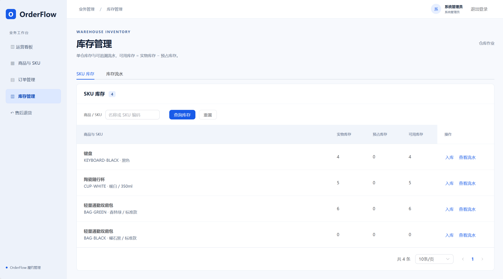
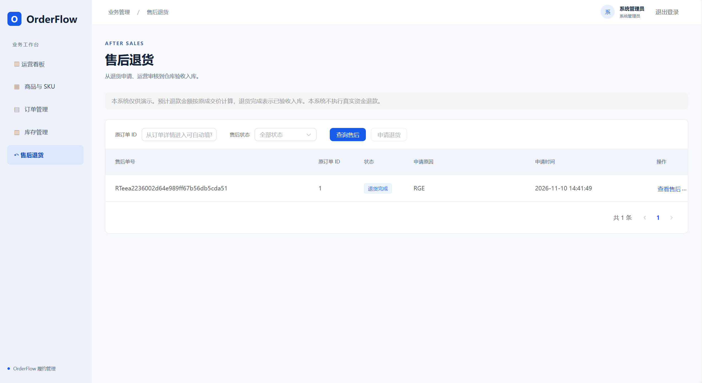

# OrderFlow · 电商订单履约与库存管理系统

面向运营与仓库协同的模块化单体后台系统，完整覆盖 **商品与 SKU 管理 → 库存入库与预占 → 多 SKU 下单 → 履约发货扣减 → 确认收货 → 部分退货审核与验收入库** 的全链路业务闭环，重点解决高并发场景下的防超卖、状态竞争、多步骤事务一致性以及细粒度角色权限控制。

> 系统定位为业务工程演示与学习项目，模拟付款、后台确认收货及退款金额核算均在站内完成闭环，未接入第三方支付网关与外部物流回执通道。

---

## 核心技术亮点

- **防超卖与防死锁预占**：通过 MySQL 原子条件更新（`quantity - reserved_quantity >= #{quantity}`）实现库存预占，并在多 SKU 下单与批量退货入库时统一按 `skuId` 升序加锁/更新，避免并发死锁；订单主表、明细快照、库存变更与 `stock_movement` 流水在同一事务内提交或回滚。
- **并发状态竞争控制**：订单支付、取消释放预占、仓库发货、确认收货以及售后审核/验收均采用带前置状态条件的原子 `UPDATE`，结合受影响行数校验拦截并发重复操作。
- **部分退货行锁防超退**：在 `READ_COMMITTED` 隔离级别下先对原订单明细执行 `SELECT ... FOR UPDATE` 行锁，再聚合校验已申请退货量，防止并发发起超过可退上限的售后单；仓库验收通过后以 `Propagation.MANDATORY` 强制事务传播回加实物库存并记录流水。
- **服务端价格快照与数据底线约束**：下单由服务端实时查询在售 SKU 单价计算总额并写入明细快照；数据库层面通过 `CHECK` 约束（实物非负、预占不超过实物）与唯一索引（`sku.code`、`stock_movement.business_key`、`order_item(order_id, sku_id)`）兜底一致性。
- **无状态 JWT 与实时账号状态校验**：基于 Spring Security + Nimbus HS256 JWT 实现无状态鉴权，每次请求从数据库实时加载账号启用状态与最新角色列表，配合 `@PreAuthorize` 在服务端严格隔离运营与仓库操作边界。

---

## 系统架构与核心流程

后端采用**按业务域垂直分包**的模块化单体架构，各业务模块内部遵循 `Controller → Service → Mapper / Entity` 分层；数据持久化使用 MyBatis-Plus 配合自定义并发控制 SQL。

### 1. 分层请求链路



### 2. 后端模块依赖



### 3. 订单履约与售后状态机



### 4. 核心实体 ER 关系

> 完整字段、索引及角色/流水关联见 [ER 图源文件](docs/ER图.mmd) 与 [数据库设计](docs/数据库设计.md)，运营看板统计口径见 [运营指标说明](docs/运营指标说明.md)。



---

## 运行截图

| 登录 | 运营看板 |
| --- | --- |
|  |  |

| 商品与 SKU | 订单管理 |
| --- | --- |
|  |  |

| 库存管理 | 售后退货 |
| --- | --- |
|  |  |

---

## 技术栈与权限模型

### 技术栈

| 层次 | 选型与版本 |
| --- | --- |
| 后端框架 | Java 21、Spring Boot 3.5.7、Spring Security 6.5.6（Web、Validation、OAuth2 Resource Server） |
| 认证方案 | BCrypt + Spring Security Nimbus JWT（HS256，`issuer=orderflow`，默认有效期 2 小时） |
| 数据访问 | MyBatis-Plus 3.5.15（含 JSqlParser 分页插件）、MySQL Connector/J 9.4.0 |
| 数据库 | MySQL 8.0.16+（InnoDB）；H2 内存库仅用于自动化回归测试 |
| 工具链 | Maven 3.6.3+、Lombok 1.18.42、springdoc-openapi 2.8.14、JUnit 5 / MockMvc |
| 前端框架 | Vue 3.5.44、Element Plus 2.11.5、Vue Router 4.6.3、Pinia 3.0.3、Axios 1.21.0、Chart.js 4.5.1 |
| 构建与测试 | Vite 7.3.7、Playwright 1.56.1、Node.js >= 22.12.0 |

### 角色权限模型

库存计算口径：`可用库存 = quantity - reserved_quantity`（下单只增预占，取消只减预占，发货同减实物与预占，退货验收只增实物）。

| 业务模块 | 核心能力 | 角色权限 |
| --- | --- | --- |
| 认证授权 | 登录签发 JWT、查询当前账号与角色状态 | 启用账号 |
| 商品 / SKU | 分页筛选、新增编辑、上下架、SKU 编码唯一性校验 | `ADMIN` / `OPERATOR` 读写，`WAREHOUSE` 只读 |
| 库存管理 | 实物/预占/可用量查询、入库操作、库存流水多维筛选 | 三角色可查，`ADMIN` / `WAREHOUSE` 入库 |
| 订单管理 | 多 SKU 下单、价格快照、模拟付款、取消释放预占 | `ADMIN` / `OPERATOR` 操作，三角色可查 |
| 履约发货 | 录入物流单号、一次完整发货、同步扣减实物与预占 | `ADMIN` / `WAREHOUSE` 发货 |
| 确认收货 | 后台确认订单完成并记录 `completed_at` | `ADMIN` / `OPERATOR` |
| 售后退货 | 已完成订单单条明细部分退货、审核、异常备注、验收入库 | `ADMIN` / `OPERATOR` 申请与审核；`ADMIN` / `WAREHOUSE` 备注与验收 |
| 运营看板 | 订单与成交趋势、商品/SKU 排行、低库存预警、售后指标 | `ADMIN` / `OPERATOR` |

---

## 快速启动

### 环境要求

- JDK 21 LTS、Maven 3.6.3+
- MySQL 8.0.16+
- Node.js 22.12+ & npm

### 1. 初始化数据库

在项目根目录依次执行建表、种子数据与增量脚本，并创建最小权限的应用账号：

```powershell
mysql --user=root --password --default-character-set=utf8mb4 --execute="source sql/001_schema.sql"
mysql --user=root --password --default-character-set=utf8mb4 --execute="source sql/002_seed.sql"
mysql --user=root --password --database=orderflow --default-character-set=utf8mb4 --execute="source sql/003_orders_reservations.sql"
mysql --user=root --password --database=orderflow --default-character-set=utf8mb4 --execute="source sql/004_fulfillment_inventory.sql"
mysql --user=root --password --database=orderflow --default-character-set=utf8mb4 --execute="source sql/005_returns_receipt.sql"
mysql --user=root --password --database=orderflow --default-character-set=utf8mb4 --execute="source sql/006_analytics_indexes.sql"
```

```sql
CREATE USER 'orderflow'@'localhost' IDENTIFIED BY '替换为你自己的数据库口令';
GRANT SELECT, INSERT, UPDATE, DELETE ON orderflow.* TO 'orderflow'@'localhost';
```

### 2. 启动后端

以 PowerShell 7 为例（首次以 `dev` Profile 启动会自动初始化 `admin`、`operator`、`warehouse` 三个账号）：

```powershell
$env:SPRING_PROFILES_ACTIVE='dev'
$env:DB_URL='jdbc:mysql://localhost:3306/orderflow?useUnicode=true&characterEncoding=UTF-8&serverTimezone=Asia/Shanghai'
$env:DB_USERNAME='orderflow'
$env:DB_PASSWORD=Read-Host '数据库口令' -MaskInput
$env:JWT_SECRET=[Convert]::ToBase64String([Security.Cryptography.RandomNumberGenerator]::GetBytes(48))
$env:DEV_SEED_PASSWORD=Read-Host '开发账号初始口令（至少12字符，最多72字节）' -MaskInput
$env:CORS_ORIGINS='http://localhost:5173'
Set-Location backend
mvn spring-boot:run
```

- 后端默认地址：`http://localhost:8080`
- 开发态接口文档：`http://localhost:8080/swagger-ui/index.html`

### 3. 启动前端

另开终端在根目录进入 `frontend`：

```powershell
Set-Location frontend
npm.cmd ci
npm.cmd run dev
```

访问 `http://localhost:5173`，使用上述初始化的 `admin` / `operator` / `warehouse` 账号登录即可体验完整流程。

---

## 目录结构

```text
OrderFlow/
├── backend/    # Spring Boot 应用源码与自动化测试
├── frontend/   # Vue 3 管理后台与 Playwright E2E 用例
├── sql/        # 001 基础表、002 种子数据、003～006 增量迁移脚本
├── docs/       # 架构说明、数据库设计、指标口径、ER 图与截图
└── scripts/    # API 烟雾测试脚本
```
